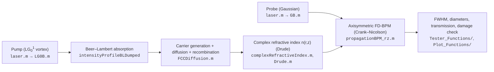

# PDE-in-Silicon

**MATLAB simulation of plasma-dispersion-effect (PDE) lensing in silicon for pump-probe super-resolution microscopy.**

A picosecond Laguerre–Gaussian *vortex* pump pulse (775 nm) is absorbed in a thinned silicon wafer and leaves behind a ring-shaped cloud of free charge carriers (FCC). Through the plasma dispersion effect the carriers lower the refractive index where they sit, so the un-pumped centre of the ring becomes a transient gradient-index (GRIN) lens. A delayed Gaussian *probe* pulse of the same wavelength is focused by that lens, and its point-spread function on the back surface of the wafer shrinks by roughly a factor of three — below the Abbe limit of the external objective.

The code reproduces the experiments of the Sinvani / Zalevsky group at Bar-Ilan University [1–3] and is the numerical engine behind the pump-width study in [1]: a 2× beam expander in the pump arm narrowed the vortex ring, reduced the focused-probe FWHM from 1.27 µm to 0.96 µm at only 20 nJ, and resolved a 0.5 µm line-and-space gold target.

---

## How the simulation works



1. **Beams.** `laser.m` builds Gaussian (`GB.m`) or LG<sub>0</sub><sup>l</sup> vortex (`LG0B.m`) fields E(r,z) with the peak amplitude set from the pulse energy, pulse width and waist.
2. **Pump absorption.** The pump intensity decays as exp(−αz) with α = 1.296×10<sup>5</sup> m<sup>−1</sup> at 775 nm (absorption depth ≈ 8 µm). One absorbed photon creates one electron–hole pair (η = 1).
3. **Carrier dynamics.** `FCCDiffusion.m` solves ∂p/∂t = D∇²p − p/τ + G(r,z,t) in cylindrical coordinates with a split Crank–Nicolson scheme (Neumann boundaries). Generation is spread over a 100 ps Gaussian envelope; D = 2.6×10<sup>−4</sup> m²/s, τ = 2.5 ns.
4. **Plasma dispersion.** `Drude.m` converts the carrier density at the pump-probe delay into Δn (negative) and Δα (positive) using the Drude free-carrier model (m<sub>e</sub>* = 0.26 m<sub>0</sub>, m<sub>h</sub>* = 0.39 m<sub>0</sub>, τ<sub>D</sub> = 10 fs), giving n<sub>c</sub>(r,z) = n + Δn + i(α + Δα)λ/4π.
5. **Probe propagation.** `propagationBPM_rz.m` propagates the probe through n<sub>c</sub>(r,z) with a scalar paraxial finite-difference beam-propagation method (half-step diffraction, full-step phase/absorption, absorbing radial mask).
6. **Analysis.** `FWHM.m` / `computeDiameter.m` measure beam widths along z, `powerLoss.m` the transmission, and `damageThreshold.m` checks the pump against the silicon damage fluence [6].

All material and numerical constants live in one place: `systemParameters.m`.

---

## Repository layout

| Path | What it contains |
|---|---|
| `systemParameters.m` | Class with every physical constant and default geometry (SI units). |
| `laser.m` | Laser-beam class: wavelength, pulse width/energy, waist, spatial profile, Beer–Lambert-damped intensity. |
| `mainProjectSimulation.m` | Driver reproducing the 2024 ACS Omega experiment [2] (35 nJ, 25 µm wafer, pump ω<sub>0</sub> = 4.24 µm). |
| `asaf.m` | Driver reproducing the beam-expander experiment [1] (20 nJ, 20 µm wafer, pump ω<sub>0</sub> = 1.329 µm, probe ω<sub>0</sub> = 1.875 µm). |
| `pumpDiameterSweep.m` | Sweep of the pump peak-to-peak diameter for 20 nJ and 35 nJ and four probe waists (narrow / medium / wide / plane wave); experimental operating points marked. Extends Figure 7 of [1]. |
| `Simulation_Functions/` | `FCCDiffusion`, `intensityToCarriers`, `complexRefractiveIndex`, `propagationBPM_rz`, `runSimulation`. |
| `Helper_Functions/` | Beam profiles (`GB`, `LG0B`), `Drude`, `BennettSoref`, cylindrical Laplacians, `cylToCart`, diameter / diffraction-limit utilities. |
| `Tester_Functions/` | Parameter studies and checks: `CheckW0`, `CheckZ0`, `CheckW0andZ0`, `CheckLGOrder`, `optimalEnergy`, `FWHM`, `powerLoss`, `damageThreshold`. |
| `Plot_Functions/` | Publication-style plots (`PF_x`, `PF_plot_xz`, `PF_x_alongz`, `PF_probeComparison`, `PF_complexRefractiveIndex`, animations). |
| `Figures_and_Results/` | Saved `.fig` files and sweep tables (`Asaf/`, `Nadav/`, `PumpDiameterSweep/`). |
| `Papers/` | Background literature and the final project report (Hebrew). |
| `unused/` | Earlier implementations kept for reference (FDFD, Maxwell solvers, etc.). Not on the active path. |
| `4y_Project_MainSimulation.prj` | MATLAB project file; opening it sets up the path. |

---

## Getting started

Requirements: MATLAB R2019b or newer (base MATLAB only; `lambertw` in `computeDiameterTheoretically.m` needs the Symbolic Math Toolbox but is optional).

```matlab
% 1. Open the project (sets the path) or add the sub-folders manually:
addpath(genpath(pwd));

% 2. Reproduce the beam-expander experiment [1]:
asaf                      % pump & probe profiles, n(r,z), focused probe, FWHM

% 3. Reproduce the 35 nJ experiment [2]:
mainProjectSimulation

% 4. Pump-diameter sweep (Figure 7 of [1], both energies, 4 probe widths):
pumpDiameterSweep         % ~10–20 min, writes Figures_and_Results/PumpDiameterSweep/
```

A minimal custom run looks like this:

```matlab
sp  = systemParameters();
r   = linspace(0, 20e-6, 2001);  z = linspace(0, sp.Lz1, 1001);  t = (0:5:200)*1e-12;

pump  = laser(sp.wl2, 30e-12, 20e-9,  "Donut", r, atan(1), z, 1.33e-6,  sp.Lz1, sp.n, 1);
probe = laser(sp.wl2, 30e-12, 0.2e-9, "Gauss", r, atan(1), z, 1.875e-6, sp.Lz1, sp.n);

p   = FCCDiffusion(pump, t, r, z);                       % carriers p(r,z,t)
[~, it] = min(abs(t - 100e-12));                         % pump-probe delay
nc  = complexRefractiveIndex(p(:,:,it), pump.lambda);    % n(r,z) at the delay
[~, I] = propagationBPM_rz(probe.profile(:,1), r, z, probe, nc, 4, 8);

fwhm_back = FWHM(I(:,end), r)                            % probe FWHM on the back surface
```

---

## Key parameters

| Quantity | Value | Where |
|---|---|---|
| Wavelength (pump and probe) | 775 nm | `sp.wl2` |
| Pulse width (intensity FWHM) | 30 ps | drivers |
| Pump : probe energy | 100 : 1 | drivers |
| Pump mode | LG<sub>0</sub><sup>1</sup> (vortex order 1) | `l = 1` |
| Pump peak-to-peak diameter | D<sub>0</sub> = ω<sub>0</sub>·√(2\|l\|) | `pumpDiameterSweep.m` |
| Silicon n, α at 775 nm | 3.7139, 1.296×10<sup>5</sup> m<sup>−1</sup> | `sp.n`, `sp.alpha` |
| Wafer thickness | 20 µm [1] / 25 µm [2] | `sp.Lz1` / `sp.Lz2` |
| Pump-probe delay | ~100 ps [1] / 60 ps [2] | drivers |
| Diffusion, recombination | 2.6×10<sup>−4</sup> m²/s, 2.5 ns | `sp.D`, `sp.tau` |
| Grid | dr = 10 nm, dz = 20 nm, dt = 5 ps | drivers |
| BPM absorbing mask | exp(−a (r/r<sub>max</sub>)<sup>b</sup>), a = 4, b = 8 | drivers |

---

## Main results

* **Beam-expander experiment [1].** With the measured pump (inner-hole width 0.91 µm) and probe (FWHM 2.77 µm) the model returns 0.911 µm, 2.774 µm and a focused-probe FWHM of 0.959 µm versus 0.96 µm measured. Without the expander (hole width 2.28 µm) it gives 1.371 µm versus 1.27 µm measured.
* **35 nJ experiment [2].** The model reproduces the focal-position and width trends with pump energy; the measured probe FWHM dropped from 2.8 to 1.2 µm.
* **Pump-diameter sweep.** Broad pumps (D<sub>0</sub> ≳ 6 µm) leave the probe size dominated by its own waist; below ~5 µm all probe widths converge to sub-micron FWHM, with a finite optimum near D<sub>0</sub> ≈ 3–4 µm rather than unlimited improvement. Resolution is bought with transmission: free-carrier absorption cuts the transmitted probe power as the lens strengthens.
* **Damage threshold.** Narrow pumps raise the peak fluence; `damageThreshold.m` (Wang et al. [6]) flags configurations that exceed the silicon damage limit, which is why energy and pump width cannot be optimised independently in the lab.

---

## Scope and limitations

The model is axisymmetric, scalar and paraxial, with ideal Gaussian / LG beams, instantaneous one-photon carrier generation and a Drude free-carrier response. It does **not** include Auger recombination, band filling, two-photon or saturated absorption, thermal effects, objective-induced spherical aberration, imperfect vortex phase, Fabry–Pérot reflections inside the wafer, or camera/noise effects. At carrier densities above ~10<sup>19</sup> cm<sup>−3</sup> (very narrow or very energetic pumps) these omissions matter. The absorbing BPM mask acts as an effective aperture of roughly 0.3–0.4 r<sub>max</sub>, so very wide probes are domain-limited; enlarge `Lr`/`Nr` when that matters. FWHM reduction alone is not a resolution criterion — the target scans in [1] are. Check grid convergence, energy normalisation and the pump-diameter definition (peak-to-peak vs inner-hole width) before comparing numbers with experiments.

---

## References

1. A. Malran, D. Adar, Z. Zalevsky, M. Sinvani, *Pump-Width-Controlled Super-Resolution Focusing in Silicon with a Single-Wavelength Vortex Pump-Probe Scheme* (manuscript, 2026). Related B.Sc. final project report: D. Adar, *Implementation of an Innovative Photonic Super-Resolution Method for Fault Monitoring in Silicon Microelectronic Chips*, Bar-Ilan University, 2026 — `Papers/דוח מסכם.pdf`.
2. N. Shabairou, Z. Zalevsky, M. Sinvani, "Laser Beam Self-Focusing in Silicon at an Absorbed Wavelength by a Vortex Beam in the Same Wavelength," *ACS Omega* **9**, 16969–16975 (2024). https://doi.org/10.1021/acsomega.3c08325
3. N. Shabairou, M. Tiferet, Z. Zalevsky, M. Sinvani, "Dynamics of Laser-Induced Tunable Focusing in Silicon," *Sci. Rep.* **12**, 6342 (2022). https://doi.org/10.1038/s41598-022-10112-3
4. H. Pinhas et al., "Plasma Dispersion Effect Based Super-Resolved Imaging in Silicon," *Opt. Express* **26**, 25370–25380 (2018). https://doi.org/10.1364/OE.26.025370
5. R. A. Soref, B. R. Bennett, "Electrooptical Effects in Silicon," *IEEE J. Quantum Electron.* **23**, 123–129 (1987).
6. X. Wang, Z. H. Shen, J. Lu, X. W. Ni, "Laser-Induced Damage Threshold of Silicon in Millisecond, Nanosecond, and Picosecond Regimes," *J. Appl. Phys.* **108**, 033103 (2010).
